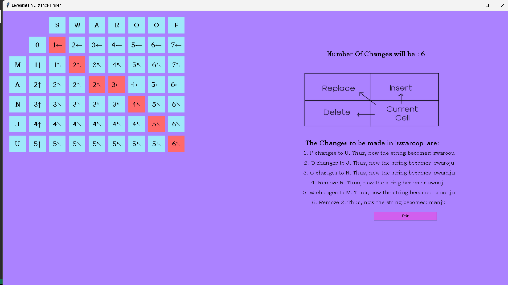
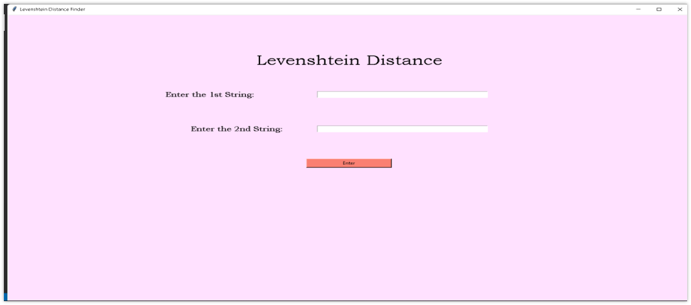

# Levenshtein Distance Finder

**Visualising Edit Distance with Dynamic Programming**

## Overview

The Levenshtein distance between two words is the smallest number of single-letter edits (insertions, deletions or substitutions) needed to turn one into the other. For example, "kitten" → "sitting" takes 3 edits: substitute k → s, substitute e → i, insert g. Edit distance is used in spell checkers, search suggestions and DNA sequence comparison.

This desktop app takes two words, fills in the dynamic-programming table cell by cell, shows the distance, then highlights the path through the table and lists each edit in order.

## Repository layout

| Path | Content |
| --- | --- |
| `Levenshtein_Distance_Finder.py` | The whole app (Tkinter GUI and the algorithm) |
| `img/` | Formula and diagram images shown inside the app |
| `output/` | Screenshots of the app |
| `LICENSE` | GNU GPL v3.0 |

## How to run

1. Install the libraries: `pip install numpy "pillow<10"` (Tkinter comes with Python; the code uses `Image.ANTIALIAS`, which was removed in Pillow 10)
2. Near the end of `Levenshtein_Distance_Finder.py`, change the two image paths to `img/Formula.png` and `img/Square_Function.png`
3. Run `python Levenshtein_Distance_Finder.py`, type two words and press **Enter**

Both inputs must contain letters only; the app shows a warning otherwise.

## How it works

| Step | Content |
| --- | --- |
| DP table | Cell (i, j) holds the distance between the first i letters of word 1 and the first j letters of word 2. Each cell stores its value and the move it came from: match, replace (↖), insert (↑) or delete (←) |
| Distance | The bottom-right cell is the answer |
| Backtrack | Walking back from the bottom-right cell recovers the edits; the path is highlighted in red |
| Change list | Each edit is listed with the word as it looks after that step |

The table has (m + 1) × (n + 1) cells for words of length m and n, so it takes O(m × n) time and memory.

## Results in figures

**Example: "manju" vs "swaroop" needs 6 edits.** The red cells trace the path through the table, and the list on the right shows each change step by step.

**Start screen** for entering the two words.

